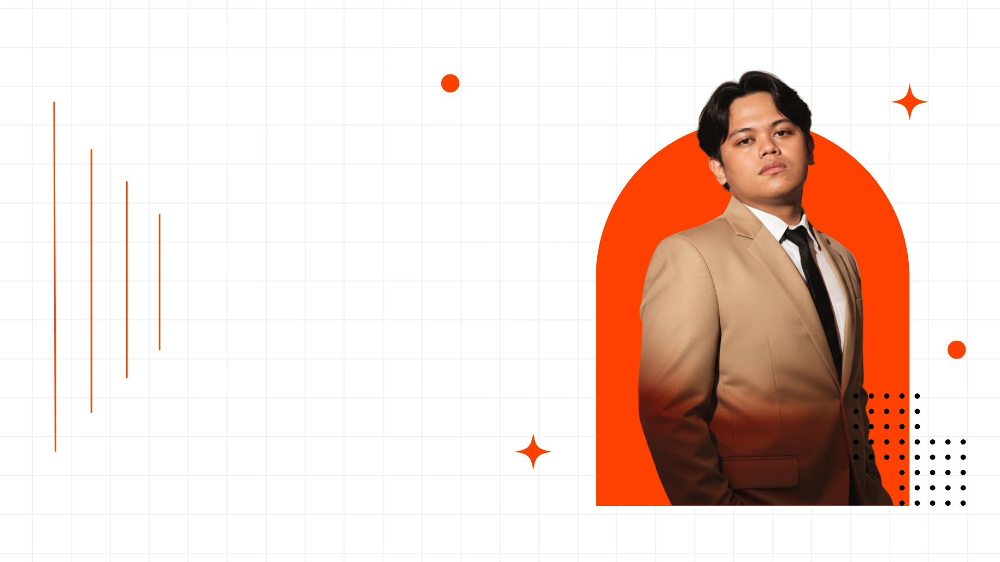

<div align="center">
  

  <h1>Irvan Afriandi · Portfolio</h1>

  <p><strong>Plan, Build, Deploy, Improve.</strong><br />A little corner of the web for my work, experience, and the things I love building.</p>

  <p>
    <a href="https://irvanafriandi.my.id"></a>
    <a href="https://github.com/IrvanAfriandi"></a>
    <a href="mailto:irvan.afriandi21@gmail.com"></a>
  </p>

  <p>
    
    
    
    
  </p>
</div>

---

## ✦ About this portfolio

Hi, I'm **Irvan Afriandi**, a web developer and frontend engineer from Surakarta, Indonesia. This portfolio brings together selected projects, professional experience, background, and ways to get in touch.

The site is built to feel lively without getting in the way: responsive layouts, carefully art-directed visuals, and motion that guides you through the page.

## ✨ What you'll find

| | Section | What's inside |
|:--:|---|---|
| 👋 | **About** | A quick introduction and the technologies I work with |
| 🧭 | **Experience** | Professional journey and work experience |
| 🛠️ | **Projects** | Selected web applications, systems, and experiments |
| 🎓 | **Background** | Education and professional credentials |
| 💌 | **Contact** | Links to connect, collaborate, or say hello |

## 🚀 Selected projects

Here are a few projects featured on the portfolio. Open a repository to explore its source code and details.

| Project | Focus | Repository |
|---|---|---|
| **Edukasi Gizi Anak SD** | Interactive nutrition learning and food-menu game | [View on GitHub ↗](https://github.com/IrvanAfriandi/game-edukasi-gizi-makanan) |
| **Aplikasi Data Karyawan** | Employee records, attendance, and leave management | [View on GitHub ↗](https://github.com/IrvanAfriandi/SIM-Karyawan-hanjuan-engineering) |
| **HyperCare** | Expert system for hypertension diagnosis during pregnancy | [View on GitHub ↗](https://github.com/IrvanAfriandi/sistem-pakar-diagnosis-penyakit-hipertensi-pada-ibu-hamil) |
| **Sistem Informasi Logistik KPU Kabupaten Cirebon** | Election logistics and distribution management | [View on GitHub ↗](https://github.com/IrvanAfriandi/sistem-logistik-kpu-kabupaten-cirebon) |
| **Sistem Penilaian Isian Singkat Otomatis** | Short-answer assessment with AI-assisted scoring | [View on GitHub ↗](https://github.com/IrvanAfriandi/sistem-penilaian-otomatis-isian-singkat) |

## 🧰 Built with

<p>
  
  
  
  
  
  
</p>

## 🏁 Run it locally

You'll need **Node.js** and **npm** installed.

```bash
# Clone the repository
git clone https://github.com/IrvanAfriandi/irvan-protofolio.git
cd irvan-protofolio

# Install dependencies
npm install

# Start the development server
npm run dev
```

Vite prints the local development URL in your terminal. To create and preview a production build:

```bash
npm run build
npm run preview
```

## 📁 Project structure

```text
├── public/                  # Static assets and project imagery
├── src/
│   ├── components/          # Portfolio sections and UI components
│   ├── styles/              # Shared visual styles
│   ├── utils/               # Small reusable helpers
│   ├── App.jsx              # Routes and page composition
│   └── main.jsx             # Application entry point
├── index.html
└── package.json
```

## 🤝 Say hello

Interested in working together or just want to chat?

<div align="center">
  <a href="mailto:irvan.afriandi21@gmail.com">Email</a> ·
  <a href="https://www.linkedin.com/in/irvan21">LinkedIn</a> ·
  <a href="https://instagram.com/riandivn">Instagram</a> ·
  <a href="https://github.com/IrvanAfriandi">GitHub</a>
</div>

<br />

<div align="center">
  <sub>Designed and built with care by <a href="https://irvanafriandi.my.id">Irvan Afriandi</a> · Surakarta, Indonesia</sub>
</div>
